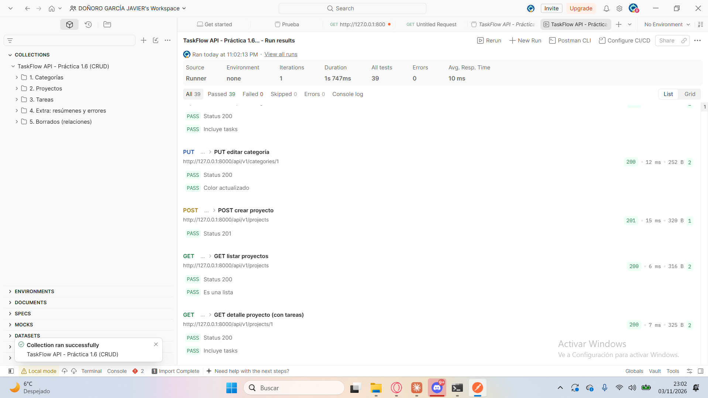

# TaskFlow API – Práctica 1.6: CRUD completo

API REST de TaskFlow (FastAPI + SQLAlchemy + SQLite) con las operaciones CRUD de **tareas**, **proyectos** y **categorías**.

- Base URL: `http://127.0.0.1:8000/api/v1`
- Documentación interactiva: `http://127.0.0.1:8000/docs`
- Colección Postman: [`TaskFlow.postman_collection.json`](TaskFlow.postman_collection.json)

## Arrancar

```bat
python -m venv .venv
.\.venv\Scripts\activate.bat
pip install -r requirements.txt
uvicorn app.main:app --reload
```

La base de datos `taskflow.db` se crea sola al arrancar.

## Endpoints

### Tareas – `routers/tasks.py`

| Método | Ruta | Descripción | Respuesta |
|---|---|---|---|
| GET | `/tasks` | Lista paginada con filtros y ordenación | 200 `Page[TaskRead]` |
| GET | `/tasks/{id}` | Detalle de una tarea | 200 / 404 |
| POST | `/tasks` | Crea una tarea | 201 / 404 / 422 |
| PUT | `/tasks/{id}` | Edita una tarea (todos los campos, incluido `completed`) | 200 / 404 / 422 |
| DELETE | `/tasks/{id}` | Elimina una tarea | 204 / 404 |

**Parámetros de `GET /tasks`** (todos opcionales y combinables):

| Parámetro | Tipo | Ejemplo | Qué hace |
|---|---|---|---|
| `project_id` | int | `1` | Solo las tareas de ese proyecto |
| `category_id` | int | `2` | Solo las tareas de esa categoría |
| `completed` | bool | `false` | `true` = completadas, `false` = pendientes |
| `search` | texto | `práctica` | Busca en el título (sin distinguir mayúsculas) |
| `sort_by` | `id`, `title`, `created_at`, `completed` | `created_at` | Campo por el que se ordena |
| `order` | `asc`, `desc` | `desc` | Sentido de la ordenación |
| `skip` | int ≥ 0 | `0` | Cuántas tareas saltar |
| `limit` | 1-100 | `20` | Tamaño de página (20 por defecto) |

La respuesta incluye **metadatos de paginación**:

```json
{
  "items": [ { "id": 1, "title": "Hacer la práctica 1.6", "completed": false, "project_id": 1, "category_id": 1, "description": null, "created_at": "..." } ],
  "total": 37,
  "skip": 0,
  "limit": 20,
  "has_more": true
}
```

### Proyectos – `routers/projects.py`

| Método | Ruta | Descripción | Respuesta |
|---|---|---|---|
| GET | `/projects` | Lista de proyectos | 200 |
| GET | `/projects/{id}` | Detalle **con sus tareas** | 200 / 404 |
| POST | `/projects` | Crea un proyecto | 201 / 422 |
| PUT | `/projects/{id}` | Edita nombre y descripción | 200 / 404 / 422 |
| DELETE | `/projects/{id}` | Elimina el proyecto **y sus tareas** | 204 / 404 |
| GET | `/projects/{id}/summary` | Contadores de tareas | 200 / 404 |

### Categorías – `routers/categories.py`

| Método | Ruta | Descripción | Respuesta |
|---|---|---|---|
| GET | `/categories` | Lista de categorías (por nombre) | 200 |
| GET | `/categories/{id}` | Detalle **con sus tareas** | 200 / 404 |
| POST | `/categories` | Crea una categoría | 201 / 409 / 422 |
| PUT | `/categories/{id}` | Edita nombre y color | 200 / 404 / 409 / 422 |
| DELETE | `/categories/{id}` | Elimina la categoría (sus tareas se quedan sin categoría) | 204 / 404 |
| GET | `/categories/{id}/summary` | Contadores de tareas | 200 / 404 |

El `color` admite un código hexadecimal (`#FF8800`, `#F80`) o un nombre (`red`). El nombre de la categoría es único y no distingue mayúsculas: `Backend` y `backend` cuentan como el mismo.

### Endpoints de resumen (contadores)

```json
GET /projects/1/summary
{ "total_tasks": 5, "completed_tasks": 1, "pending_tasks": 4, "completion_rate": 20.0 }
```

## Qué pasa al borrar (gestión de relaciones)

| Se borra… | Sus tareas… | Dónde se aplica |
|---|---|---|
| Un **proyecto** | **Se borran** (cascada) | ORM: `cascade="all, delete"` · BD: `ForeignKey(..., ondelete="CASCADE")` |
| Una **categoría** | **Se quedan sin categoría** (`category_id = null`) | ORM: relación sin cascada · BD: `ForeignKey(..., ondelete="SET NULL")` |

**Por qué decido así:**

- **Proyecto → cascada.** Las tareas de un proyecto forman parte de él. Si al borrarlo las dejara sueltas, se irían acumulando tareas sin contexto que nadie sabría de dónde vienen. El documento del proyecto (RF-12) pide que esta decisión sea explícita y consistente, y lo es: se aplica tanto en el ORM como en la propia BD, así que da igual por dónde se borre.
- **Categoría → desasociar.** Una categoría es solo una etiqueta. Borrar la etiqueta "Backend" no debe hacer desaparecer el trabajo que tenía asignado; las tareas siguen existiendo, solo que sin categoría.
- **Mensaje claro:** la respuesta 204 incluye una cabecera que dice qué ha pasado: `X-Deleted-Tasks: 5` al borrar un proyecto y `X-Unlinked-Tasks: 3` al borrar una categoría. Las dos están en `expose_headers` de CORS para que el frontend pueda leerlas.
- En SQLite, el `ondelete` solo funciona si las claves foráneas están activadas (`PRAGMA foreign_keys=ON`). Se activan en `core/database.py` en cada conexión.

## Errores

Todos los errores tienen el mismo formato, y el `error_code` es **distinto según la causa**:

```json
{ "error": "El proyecto con id 42 no existe", "error_code": "PROJECT_NOT_FOUND", "request_id": "8f59d6b9..." }
```

| HTTP | `error_code` | Cuándo |
|---|---|---|
| 404 | `TASK_NOT_FOUND` | La tarea del `{id}` no existe |
| 404 | `PROJECT_NOT_FOUND` | El proyecto no existe (en la URL o en el `project_id` del body) |
| 404 | `CATEGORY_NOT_FOUND` | La categoría no existe (en la URL o en el `category_id` del body) |
| 409 | `CATEGORY_NAME_TAKEN` | Ya hay una categoría con ese nombre |
| 422 | `VALIDATION_ERROR` | Datos no válidos (título vacío, color mal escrito, `limit` > 100…). Incluye `errors` con el campo y el motivo |
| 500 | `INTERNAL_ERROR` | Error inesperado (el detalle solo queda en el log) |

## Optimización de consultas

- **Sin N+1 en los detalles:** `GET /projects/{id}` y `GET /categories/{id}` usan `selectinload`, así que el recurso y todas sus tareas se cargan con **2 consultas fijas**, tenga las tareas que tenga. Sin esto se haría 1 consulta más por cada tarea.
- **Contadores en la BD:** `total` en la paginación y los `/summary` usan `COUNT` y `SUM(CASE ...)` en una sola consulta, en lugar de traer todas las tareas a Python para contarlas.
- **Paginación en SQL:** `OFFSET`/`LIMIT` se aplican en la consulta, así que nunca se cargan más filas de las que se devuelven. El `limit` máximo es 100.
- **Índices** en las FKs `tasks.project_id` y `tasks.category_id`, que son justo las columnas por las que se filtra.
- **Ordenación segura:** `sort_by` solo acepta una lista cerrada de columnas, nunca texto libre del cliente.

## Colección Postman

Archivo: `TaskFlow.postman_collection.json`. Se importa en Postman con **Import** y se ejecuta entera con **Run collection**.

| Carpeta | Peticiones |
|---|---|
| 1. Categorías | POST, GET lista, GET detalle, PUT |
| 2. Proyectos | POST, GET lista, GET detalle, PUT |
| 3. Tareas | POST, GET lista (filtros + paginación), GET detalle, PUT, DELETE |
| 4. Extra | resúmenes, ordenación/búsqueda, errores 404/409/422 |
| 5. Borrados | DELETE categoría, DELETE proyecto |

Son **las 15 peticiones del contrato**, más 8 extra. Cada una lleva tests que comprueban el código de respuesta, y las de creación guardan el id en variables de la colección (`project_id`, `category_id`, `task_id`), así que no hay que copiar ids a mano. Los borrados de proyecto y categoría van al final porque eliminan los datos que usan las demás.

Resultado de **Run collection**: 23 peticiones y 39 tests, todos correctos.



## Estructura

```
app/
├── main.py
├── core/          config, database, deps, errors, logging, middleware, queries, security
├── models/        models.py (User, Project, Category, Task)
├── schemas/       common (Page, TaskCounters), task, project, category, user
└── routers/       system, users, projects, categories, tasks
```
